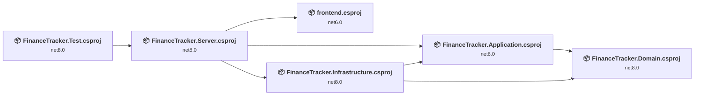
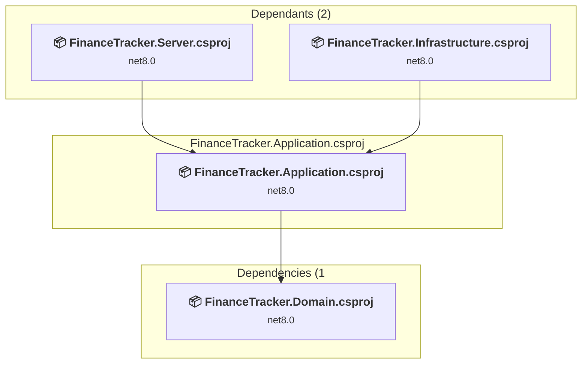
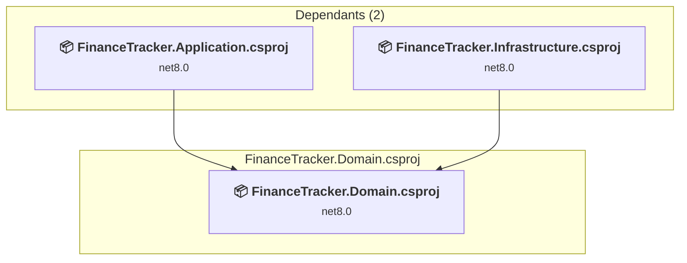
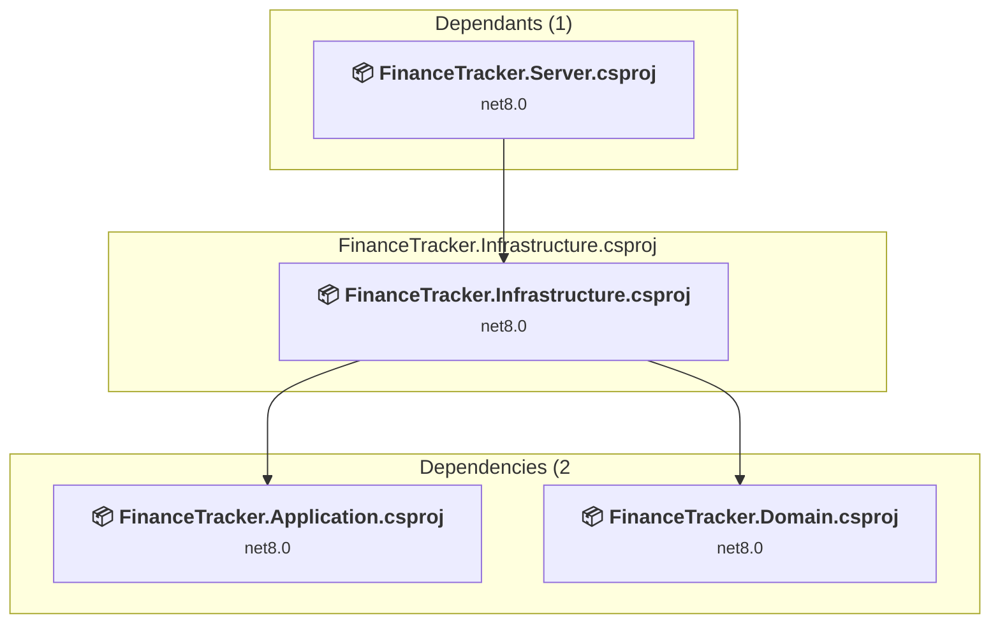
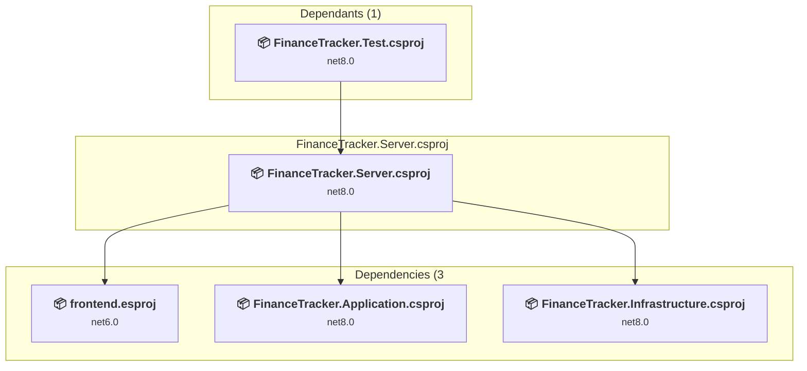
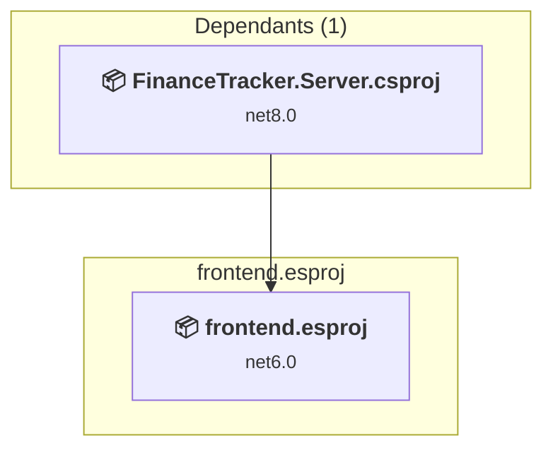
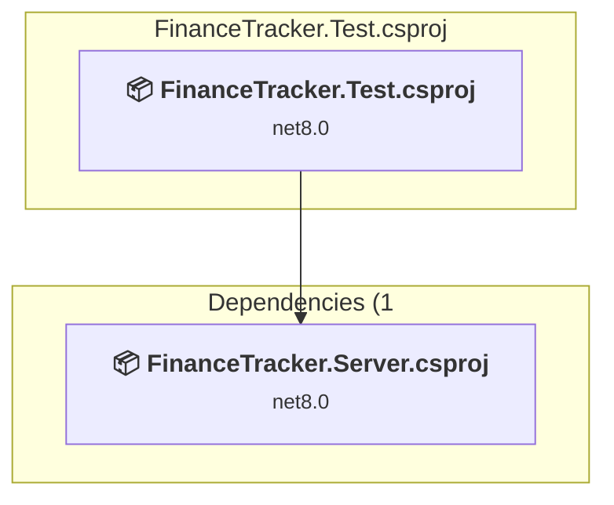

# Projects and dependencies analysis

This document provides a comprehensive overview of the projects and their dependencies in the context of upgrading to .NETCoreApp,Version=v10.0.

## Table of Contents

- [Executive Summary](#executive-Summary)
  - [Highlevel Metrics](#highlevel-metrics)
  - [Projects Compatibility](#projects-compatibility)
  - [Package Compatibility](#package-compatibility)
  - [API Compatibility](#api-compatibility)
  - [Binding Redirect Configuration](#binding-redirect-configuration)
- [Aggregate NuGet packages details](#aggregate-nuget-packages-details)
- [Top API Migration Challenges](#top-api-migration-challenges)
  - [Technologies and Features](#technologies-and-features)
  - [Most Frequent API Issues](#most-frequent-api-issues)
- [Projects Relationship Graph](#projects-relationship-graph)
- [Project Details](#project-details)

  - [backend\FinanceTracker.Application\FinanceTracker.Application.csproj](#backendfinancetrackerapplicationfinancetrackerapplicationcsproj)
  - [backend\FinanceTracker.Domain\FinanceTracker.Domain.csproj](#backendfinancetrackerdomainfinancetrackerdomaincsproj)
  - [backend\FinanceTracker.Infrastructure\FinanceTracker.Infrastructure.csproj](#backendfinancetrackerinfrastructurefinancetrackerinfrastructurecsproj)
  - [backend\FinanceTracker.Server\FinanceTracker.Server.csproj](#backendfinancetrackerserverfinancetrackerservercsproj)
  - [frontend\frontend.esproj](#frontendfrontendesproj)
  - [tests\FinanceTracker.Test\FinanceTracker.Test.csproj](#testsfinancetrackertestfinancetrackertestcsproj)

## Executive Summary

### Highlevel Metrics

| Metric | Count | Status |
| :--- | :---: | :--- |
| Total Projects | 6 | All require upgrade |
| Total NuGet Packages | 226 | 14 need upgrade |
| Total Code Files | 169 |  |
| Total Code Files with Incidents | 16 |  |
| Total Lines of Code | 9312 |  |
| Total Number of Issues | 72 |  |
| Estimated LOC to modify | 49+ | at least 0,5% of codebase |

### Projects Compatibility

| Project | Target Framework | Difficulty | Package Issues | API Issues | Binding Issues | Est. LOC Impact | Description |
| :--- | :---: | :---: | :---: | :---: | :---: | :---: | :--- |
| [backend\FinanceTracker.Application\FinanceTracker.Application.csproj](#backendfinancetrackerapplicationfinancetrackerapplicationcsproj) | net8.0 | 🟢 Low | 1 | 1 | 0 | 1+ | ClassLibrary, Sdk Style = True |
| [backend\FinanceTracker.Domain\FinanceTracker.Domain.csproj](#backendfinancetrackerdomainfinancetrackerdomaincsproj) | net8.0 | 🟢 Low | 0 | 0 | 0 |  | ClassLibrary, Sdk Style = True |
| [backend\FinanceTracker.Infrastructure\FinanceTracker.Infrastructure.csproj](#backendfinancetrackerinfrastructurefinancetrackerinfrastructurecsproj) | net8.0 | 🟢 Low | 5 | 34 | 0 | 34+ | ClassLibrary, Sdk Style = True |
| [backend\FinanceTracker.Server\FinanceTracker.Server.csproj](#backendfinancetrackerserverfinancetrackerservercsproj) | net8.0 | 🟢 Low | 7 | 14 | 0 | 14+ | AspNetCore, Sdk Style = True |
| [frontend\frontend.esproj](#frontendfrontendesproj) | net6.0 | 🟢 Low | 0 | 0 | 0 |  | DotNetCoreApp, Sdk Style = True |
| [tests\FinanceTracker.Test\FinanceTracker.Test.csproj](#testsfinancetrackertestfinancetrackertestcsproj) | net8.0 | 🟢 Low | 4 | 0 | 0 |  | DotNetCoreApp, Sdk Style = True |

### Package Compatibility

| Status | Count | Percentage |
| :--- | :---: | :---: |
| ✅ Compatible | 212 | 93,8% |
| ⚠️ Incompatible | 1 | 0,4% |
| 🔄 Upgrade Recommended | 13 | 5,8% |
| ***Total NuGet Packages*** | ***226*** | ***100%*** |

### API Compatibility

| Category | Count | Impact |
| :--- | :---: | :--- |
| 🔴 Binary Incompatible | 11 | High - Require code changes |
| 🟡 Source Incompatible | 24 | Medium - Needs re-compilation and potential conflicting API error fixing |
| 🔵 Behavioral change | 14 | Low - Behavioral changes that may require testing at runtime |
| ✅ Compatible | 14083 |  |
| ***Total APIs Analyzed*** | ***14132*** |  |

## Aggregate NuGet packages details

| Package | Current Version | Suggested Version | Projects | Description |
| :--- | :---: | :---: | :--- | :--- |
| Apache.Arrow | 22.1.0 |  | [FinanceTracker.Infrastructure.csproj](#backendfinancetrackerinfrastructurefinancetrackerinfrastructurecsproj) [FinanceTracker.Server.csproj](#backendfinancetrackerserverfinancetrackerservercsproj) [FinanceTracker.Test.csproj](#testsfinancetrackertestfinancetrackertestcsproj) | ✅Compatible |
| Azure.AI.DocumentIntelligence | 1.0.0 |  | [FinanceTracker.Infrastructure.csproj](#backendfinancetrackerinfrastructurefinancetrackerinfrastructurecsproj) [FinanceTracker.Server.csproj](#backendfinancetrackerserverfinancetrackerservercsproj) [FinanceTracker.Test.csproj](#testsfinancetrackertestfinancetrackertestcsproj) | ✅Compatible |
| Azure.Core | 1.60.0 |  | [FinanceTracker.Infrastructure.csproj](#backendfinancetrackerinfrastructurefinancetrackerinfrastructurecsproj) [FinanceTracker.Server.csproj](#backendfinancetrackerserverfinancetrackerservercsproj) [FinanceTracker.Test.csproj](#testsfinancetrackertestfinancetrackertestcsproj) | ✅Compatible |
| Azure.Identity | 1.21.0 |  | [FinanceTracker.Infrastructure.csproj](#backendfinancetrackerinfrastructurefinancetrackerinfrastructurecsproj) [FinanceTracker.Server.csproj](#backendfinancetrackerserverfinancetrackerservercsproj) [FinanceTracker.Test.csproj](#testsfinancetrackertestfinancetrackertestcsproj) | ✅Compatible |
| Azure.Monitor.OpenTelemetry.AspNetCore | 1.6.0 |  | [FinanceTracker.Server.csproj](#backendfinancetrackerserverfinancetrackerservercsproj) [FinanceTracker.Test.csproj](#testsfinancetrackertestfinancetrackertestcsproj) | ✅Compatible |
| Azure.Monitor.OpenTelemetry.Exporter | 1.8.3 |  | [FinanceTracker.Server.csproj](#backendfinancetrackerserverfinancetrackerservercsproj) [FinanceTracker.Test.csproj](#testsfinancetrackertestfinancetrackertestcsproj) | ✅Compatible |
| Azure.Storage.Blobs | 12.30.1 |  | [FinanceTracker.Infrastructure.csproj](#backendfinancetrackerinfrastructurefinancetrackerinfrastructurecsproj) [FinanceTracker.Server.csproj](#backendfinancetrackerserverfinancetrackerservercsproj) [FinanceTracker.Test.csproj](#testsfinancetrackertestfinancetrackertestcsproj) | ✅Compatible |
| Azure.Storage.Common | 12.29.0 |  | [FinanceTracker.Infrastructure.csproj](#backendfinancetrackerinfrastructurefinancetrackerinfrastructurecsproj) [FinanceTracker.Server.csproj](#backendfinancetrackerserverfinancetrackerservercsproj) [FinanceTracker.Test.csproj](#testsfinancetrackertestfinancetrackertestcsproj) | ✅Compatible |
| BCrypt.Net-Next | 4.0.3 |  | [FinanceTracker.Infrastructure.csproj](#backendfinancetrackerinfrastructurefinancetrackerinfrastructurecsproj) [FinanceTracker.Server.csproj](#backendfinancetrackerserverfinancetrackerservercsproj) [FinanceTracker.Test.csproj](#testsfinancetrackertestfinancetrackertestcsproj) | ✅Compatible |
| Castle.Core | 5.1.1 |  | [FinanceTracker.Test.csproj](#testsfinancetrackertestfinancetrackertestcsproj) | ✅Compatible |
| coverlet.collector | 10.1.0 |  | [FinanceTracker.Test.csproj](#testsfinancetrackertestfinancetrackertestcsproj) | ✅Compatible |
| FluentValidation | 12.0.0 |  | [FinanceTracker.Application.csproj](#backendfinancetrackerapplicationfinancetrackerapplicationcsproj) [FinanceTracker.Infrastructure.csproj](#backendfinancetrackerinfrastructurefinancetrackerinfrastructurecsproj) [FinanceTracker.Server.csproj](#backendfinancetrackerserverfinancetrackerservercsproj) [FinanceTracker.Test.csproj](#testsfinancetrackertestfinancetrackertestcsproj) | ✅Compatible |
| FluentValidation.DependencyInjectionExtensions | 12.0.0 |  | [FinanceTracker.Application.csproj](#backendfinancetrackerapplicationfinancetrackerapplicationcsproj) [FinanceTracker.Infrastructure.csproj](#backendfinancetrackerinfrastructurefinancetrackerinfrastructurecsproj) [FinanceTracker.Server.csproj](#backendfinancetrackerserverfinancetrackerservercsproj) [FinanceTracker.Test.csproj](#testsfinancetrackertestfinancetrackertestcsproj) | ✅Compatible |
| Google.Apis | 1.70.0 |  | [FinanceTracker.Infrastructure.csproj](#backendfinancetrackerinfrastructurefinancetrackerinfrastructurecsproj) [FinanceTracker.Server.csproj](#backendfinancetrackerserverfinancetrackerservercsproj) [FinanceTracker.Test.csproj](#testsfinancetrackertestfinancetrackertestcsproj) | ✅Compatible |
| Google.Apis.Auth | 1.70.0 |  | [FinanceTracker.Infrastructure.csproj](#backendfinancetrackerinfrastructurefinancetrackerinfrastructurecsproj) [FinanceTracker.Server.csproj](#backendfinancetrackerserverfinancetrackerservercsproj) [FinanceTracker.Test.csproj](#testsfinancetrackertestfinancetrackertestcsproj) | ✅Compatible |
| Google.Apis.Core | 1.70.0 |  | [FinanceTracker.Infrastructure.csproj](#backendfinancetrackerinfrastructurefinancetrackerinfrastructurecsproj) [FinanceTracker.Server.csproj](#backendfinancetrackerserverfinancetrackerservercsproj) [FinanceTracker.Test.csproj](#testsfinancetrackertestfinancetrackertestcsproj) | ✅Compatible |
| Google.Protobuf | 3.30.1 |  | [FinanceTracker.Server.csproj](#backendfinancetrackerserverfinancetrackerservercsproj) [FinanceTracker.Test.csproj](#testsfinancetrackertestfinancetrackertestcsproj) | ✅Compatible |
| Grpc.Core.Api | 2.70.0 |  | [FinanceTracker.Server.csproj](#backendfinancetrackerserverfinancetrackerservercsproj) [FinanceTracker.Test.csproj](#testsfinancetrackertestfinancetrackertestcsproj) | ✅Compatible |
| Grpc.Net.Client | 2.70.0 |  | [FinanceTracker.Server.csproj](#backendfinancetrackerserverfinancetrackerservercsproj) [FinanceTracker.Test.csproj](#testsfinancetrackertestfinancetrackertestcsproj) | ✅Compatible |
| Grpc.Net.Common | 2.70.0 |  | [FinanceTracker.Server.csproj](#backendfinancetrackerserverfinancetrackerservercsproj) [FinanceTracker.Test.csproj](#testsfinancetrackertestfinancetrackertestcsproj) | ✅Compatible |
| Humanizer.Core | 2.14.1 |  | [FinanceTracker.Server.csproj](#backendfinancetrackerserverfinancetrackerservercsproj) | ✅Compatible |
| Microsoft.AspNetCore.Authentication.JwtBearer | 8.0.13 | 10.0.15 | [FinanceTracker.Infrastructure.csproj](#backendfinancetrackerinfrastructurefinancetrackerinfrastructurecsproj) [FinanceTracker.Server.csproj](#backendfinancetrackerserverfinancetrackerservercsproj) [FinanceTracker.Test.csproj](#testsfinancetrackertestfinancetrackertestcsproj) | NuGet package upgrade is recommended |
| Microsoft.AspNetCore.SpaProxy | 8.0.34 | 10.0.15 | [FinanceTracker.Server.csproj](#backendfinancetrackerserverfinancetrackerservercsproj) [FinanceTracker.Test.csproj](#testsfinancetrackertestfinancetrackertestcsproj) | NuGet package upgrade is recommended |
| Microsoft.Bcl.AsyncInterfaces | 10.0.9 |  | [FinanceTracker.Infrastructure.csproj](#backendfinancetrackerinfrastructurefinancetrackerinfrastructurecsproj) [FinanceTracker.Server.csproj](#backendfinancetrackerserverfinancetrackerservercsproj) [FinanceTracker.Test.csproj](#testsfinancetrackertestfinancetrackertestcsproj) | ✅Compatible |
| Microsoft.CodeAnalysis.Analyzers | 3.3.3 |  | [FinanceTracker.Server.csproj](#backendfinancetrackerserverfinancetrackerservercsproj) | ✅Compatible |
| Microsoft.CodeAnalysis.Common | 4.5.0 |  | [FinanceTracker.Server.csproj](#backendfinancetrackerserverfinancetrackerservercsproj) | ✅Compatible |
| Microsoft.CodeAnalysis.CSharp | 4.5.0 |  | [FinanceTracker.Server.csproj](#backendfinancetrackerserverfinancetrackerservercsproj) | ✅Compatible |
| Microsoft.CodeAnalysis.CSharp.Workspaces | 4.5.0 |  | [FinanceTracker.Server.csproj](#backendfinancetrackerserverfinancetrackerservercsproj) | ✅Compatible |
| Microsoft.CodeAnalysis.Workspaces.Common | 4.5.0 |  | [FinanceTracker.Server.csproj](#backendfinancetrackerserverfinancetrackerservercsproj) | ✅Compatible |
| Microsoft.CodeCoverage | 17.8.0 |  | [FinanceTracker.Test.csproj](#testsfinancetrackertestfinancetrackertestcsproj) | ✅Compatible |
| Microsoft.Data.SqlClient | 5.1.6 |  | [FinanceTracker.Infrastructure.csproj](#backendfinancetrackerinfrastructurefinancetrackerinfrastructurecsproj) [FinanceTracker.Server.csproj](#backendfinancetrackerserverfinancetrackerservercsproj) [FinanceTracker.Test.csproj](#testsfinancetrackertestfinancetrackertestcsproj) | ✅Compatible |
| Microsoft.Data.SqlClient.SNI.runtime | 5.1.1 |  | [FinanceTracker.Infrastructure.csproj](#backendfinancetrackerinfrastructurefinancetrackerinfrastructurecsproj) [FinanceTracker.Server.csproj](#backendfinancetrackerserverfinancetrackerservercsproj) [FinanceTracker.Test.csproj](#testsfinancetrackertestfinancetrackertestcsproj) | ✅Compatible |
| Microsoft.EntityFrameworkCore | 8.0.14 | 10.0.15 | [FinanceTracker.Infrastructure.csproj](#backendfinancetrackerinfrastructurefinancetrackerinfrastructurecsproj) | NuGet package upgrade is recommended |
| Microsoft.EntityFrameworkCore | 8.0.31 | 10.0.15 | [FinanceTracker.Server.csproj](#backendfinancetrackerserverfinancetrackerservercsproj) [FinanceTracker.Test.csproj](#testsfinancetrackertestfinancetrackertestcsproj) | NuGet package upgrade is recommended |
| Microsoft.EntityFrameworkCore.Abstractions | 8.0.14 |  | [FinanceTracker.Infrastructure.csproj](#backendfinancetrackerinfrastructurefinancetrackerinfrastructurecsproj) | ✅Compatible |
| Microsoft.EntityFrameworkCore.Abstractions | 8.0.31 |  | [FinanceTracker.Server.csproj](#backendfinancetrackerserverfinancetrackerservercsproj) [FinanceTracker.Test.csproj](#testsfinancetrackertestfinancetrackertestcsproj) | ✅Compatible |
| Microsoft.EntityFrameworkCore.Analyzers | 8.0.14 |  | [FinanceTracker.Infrastructure.csproj](#backendfinancetrackerinfrastructurefinancetrackerinfrastructurecsproj) | ✅Compatible |
| Microsoft.EntityFrameworkCore.Analyzers | 8.0.31 |  | [FinanceTracker.Server.csproj](#backendfinancetrackerserverfinancetrackerservercsproj) [FinanceTracker.Test.csproj](#testsfinancetrackertestfinancetrackertestcsproj) | ✅Compatible |
| Microsoft.EntityFrameworkCore.Design | 8.0.31 | 10.0.15 | [FinanceTracker.Server.csproj](#backendfinancetrackerserverfinancetrackerservercsproj) | NuGet package upgrade is recommended |
| Microsoft.EntityFrameworkCore.Relational | 8.0.13 |  | [FinanceTracker.Infrastructure.csproj](#backendfinancetrackerinfrastructurefinancetrackerinfrastructurecsproj) | ✅Compatible |
| Microsoft.EntityFrameworkCore.Relational | 8.0.31 | 10.0.15 | [FinanceTracker.Server.csproj](#backendfinancetrackerserverfinancetrackerservercsproj) [FinanceTracker.Test.csproj](#testsfinancetrackertestfinancetrackertestcsproj) | NuGet package upgrade is recommended |
| Microsoft.EntityFrameworkCore.SqlServer | 8.0.13 | 10.0.15 | [FinanceTracker.Infrastructure.csproj](#backendfinancetrackerinfrastructurefinancetrackerinfrastructurecsproj) | NuGet package upgrade is recommended |
| Microsoft.EntityFrameworkCore.SqlServer | 8.0.20 | 10.0.15 | [FinanceTracker.Server.csproj](#backendfinancetrackerserverfinancetrackerservercsproj) [FinanceTracker.Test.csproj](#testsfinancetrackertestfinancetrackertestcsproj) | NuGet package upgrade is recommended |
| Microsoft.EntityFrameworkCore.Tools | 8.0.31 | 10.0.15 | [FinanceTracker.Server.csproj](#backendfinancetrackerserverfinancetrackerservercsproj) | NuGet package upgrade is recommended |
| Microsoft.Extensions.ApiDescription.Server | 6.0.5 |  | [FinanceTracker.Server.csproj](#backendfinancetrackerserverfinancetrackerservercsproj) [FinanceTracker.Test.csproj](#testsfinancetrackertestfinancetrackertestcsproj) | ✅Compatible |
| Microsoft.Extensions.Caching.Abstractions | 8.0.0 |  | [FinanceTracker.Infrastructure.csproj](#backendfinancetrackerinfrastructurefinancetrackerinfrastructurecsproj) [FinanceTracker.Server.csproj](#backendfinancetrackerserverfinancetrackerservercsproj) [FinanceTracker.Test.csproj](#testsfinancetrackertestfinancetrackertestcsproj) | ✅Compatible |
| Microsoft.Extensions.Caching.Memory | 8.0.1 |  | [FinanceTracker.Infrastructure.csproj](#backendfinancetrackerinfrastructurefinancetrackerinfrastructurecsproj) [FinanceTracker.Server.csproj](#backendfinancetrackerserverfinancetrackerservercsproj) [FinanceTracker.Test.csproj](#testsfinancetrackertestfinancetrackertestcsproj) | ✅Compatible |
| Microsoft.Extensions.Configuration | 10.0.0 |  | [FinanceTracker.Server.csproj](#backendfinancetrackerserverfinancetrackerservercsproj) [FinanceTracker.Test.csproj](#testsfinancetrackertestfinancetrackertestcsproj) | ✅Compatible |
| Microsoft.Extensions.Configuration.Abstractions | 10.0.14 | 10.0.15 | [FinanceTracker.Infrastructure.csproj](#backendfinancetrackerinfrastructurefinancetrackerinfrastructurecsproj) [FinanceTracker.Server.csproj](#backendfinancetrackerserverfinancetrackerservercsproj) [FinanceTracker.Test.csproj](#testsfinancetrackertestfinancetrackertestcsproj) | NuGet package upgrade is recommended |
| Microsoft.Extensions.Configuration.Binder | 10.0.0 |  | [FinanceTracker.Server.csproj](#backendfinancetrackerserverfinancetrackerservercsproj) [FinanceTracker.Test.csproj](#testsfinancetrackertestfinancetrackertestcsproj) | ✅Compatible |
| Microsoft.Extensions.Configuration.EnvironmentVariables | 8.0.0 |  | [FinanceTracker.Server.csproj](#backendfinancetrackerserverfinancetrackerservercsproj) [FinanceTracker.Test.csproj](#testsfinancetrackertestfinancetrackertestcsproj) | ✅Compatible |
| Microsoft.Extensions.DependencyInjection | 10.0.0 |  | [FinanceTracker.Server.csproj](#backendfinancetrackerserverfinancetrackerservercsproj) [FinanceTracker.Test.csproj](#testsfinancetrackertestfinancetrackertestcsproj) | ✅Compatible |
| Microsoft.Extensions.DependencyInjection | 8.0.1 |  | [FinanceTracker.Infrastructure.csproj](#backendfinancetrackerinfrastructurefinancetrackerinfrastructurecsproj) | ✅Compatible |
| Microsoft.Extensions.DependencyInjection.Abstractions | 10.0.14 | 10.0.15 | [FinanceTracker.Infrastructure.csproj](#backendfinancetrackerinfrastructurefinancetrackerinfrastructurecsproj) [FinanceTracker.Server.csproj](#backendfinancetrackerserverfinancetrackerservercsproj) [FinanceTracker.Test.csproj](#testsfinancetrackertestfinancetrackertestcsproj) | NuGet package upgrade is recommended |
| Microsoft.Extensions.DependencyInjection.Abstractions | 9.0.9 | 10.0.15 | [FinanceTracker.Application.csproj](#backendfinancetrackerapplicationfinancetrackerapplicationcsproj) | NuGet package upgrade is recommended |
| Microsoft.Extensions.DependencyModel | 10.0.0 |  | [FinanceTracker.Server.csproj](#backendfinancetrackerserverfinancetrackerservercsproj) [FinanceTracker.Test.csproj](#testsfinancetrackertestfinancetrackertestcsproj) | ✅Compatible |
| Microsoft.Extensions.Diagnostics.Abstractions | 10.0.9 |  | [FinanceTracker.Infrastructure.csproj](#backendfinancetrackerinfrastructurefinancetrackerinfrastructurecsproj) [FinanceTracker.Server.csproj](#backendfinancetrackerserverfinancetrackerservercsproj) [FinanceTracker.Test.csproj](#testsfinancetrackertestfinancetrackertestcsproj) | ✅Compatible |
| Microsoft.Extensions.Diagnostics.HealthChecks | 8.0.31 |  | [FinanceTracker.Server.csproj](#backendfinancetrackerserverfinancetrackerservercsproj) [FinanceTracker.Test.csproj](#testsfinancetrackertestfinancetrackertestcsproj) | ✅Compatible |
| Microsoft.Extensions.Diagnostics.HealthChecks.Abstractions | 8.0.31 |  | [FinanceTracker.Server.csproj](#backendfinancetrackerserverfinancetrackerservercsproj) [FinanceTracker.Test.csproj](#testsfinancetrackertestfinancetrackertestcsproj) | ✅Compatible |
| Microsoft.Extensions.Diagnostics.HealthChecks.EntityFrameworkCore | 8.0.31 | 10.0.15 | [FinanceTracker.Server.csproj](#backendfinancetrackerserverfinancetrackerservercsproj) [FinanceTracker.Test.csproj](#testsfinancetrackertestfinancetrackertestcsproj) | NuGet package upgrade is recommended |
| Microsoft.Extensions.FileProviders.Abstractions | 10.0.9 |  | [FinanceTracker.Infrastructure.csproj](#backendfinancetrackerinfrastructurefinancetrackerinfrastructurecsproj) [FinanceTracker.Server.csproj](#backendfinancetrackerserverfinancetrackerservercsproj) [FinanceTracker.Test.csproj](#testsfinancetrackertestfinancetrackertestcsproj) | ✅Compatible |
| Microsoft.Extensions.Hosting.Abstractions | 10.0.9 |  | [FinanceTracker.Infrastructure.csproj](#backendfinancetrackerinfrastructurefinancetrackerinfrastructurecsproj) [FinanceTracker.Server.csproj](#backendfinancetrackerserverfinancetrackerservercsproj) [FinanceTracker.Test.csproj](#testsfinancetrackertestfinancetrackertestcsproj) | ✅Compatible |
| Microsoft.Extensions.Logging | 10.0.0 |  | [FinanceTracker.Server.csproj](#backendfinancetrackerserverfinancetrackerservercsproj) [FinanceTracker.Test.csproj](#testsfinancetrackertestfinancetrackertestcsproj) | ✅Compatible |
| Microsoft.Extensions.Logging | 8.0.1 |  | [FinanceTracker.Infrastructure.csproj](#backendfinancetrackerinfrastructurefinancetrackerinfrastructurecsproj) | ✅Compatible |
| Microsoft.Extensions.Logging.Abstractions | 10.0.9 |  | [FinanceTracker.Infrastructure.csproj](#backendfinancetrackerinfrastructurefinancetrackerinfrastructurecsproj) [FinanceTracker.Server.csproj](#backendfinancetrackerserverfinancetrackerservercsproj) [FinanceTracker.Test.csproj](#testsfinancetrackertestfinancetrackertestcsproj) | ✅Compatible |
| Microsoft.Extensions.Logging.Configuration | 8.0.0 |  | [FinanceTracker.Server.csproj](#backendfinancetrackerserverfinancetrackerservercsproj) [FinanceTracker.Test.csproj](#testsfinancetrackertestfinancetrackertestcsproj) | ✅Compatible |
| Microsoft.Extensions.Options | 10.0.9 |  | [FinanceTracker.Infrastructure.csproj](#backendfinancetrackerinfrastructurefinancetrackerinfrastructurecsproj) [FinanceTracker.Server.csproj](#backendfinancetrackerserverfinancetrackerservercsproj) [FinanceTracker.Test.csproj](#testsfinancetrackertestfinancetrackertestcsproj) | ✅Compatible |
| Microsoft.Extensions.Options.ConfigurationExtensions | 8.0.0 |  | [FinanceTracker.Server.csproj](#backendfinancetrackerserverfinancetrackerservercsproj) [FinanceTracker.Test.csproj](#testsfinancetrackertestfinancetrackertestcsproj) | ✅Compatible |
| Microsoft.Extensions.Primitives | 10.0.14 |  | [FinanceTracker.Infrastructure.csproj](#backendfinancetrackerinfrastructurefinancetrackerinfrastructurecsproj) [FinanceTracker.Server.csproj](#backendfinancetrackerserverfinancetrackerservercsproj) [FinanceTracker.Test.csproj](#testsfinancetrackertestfinancetrackertestcsproj) | ✅Compatible |
| Microsoft.Identity.Client | 4.84.2 |  | [FinanceTracker.Infrastructure.csproj](#backendfinancetrackerinfrastructurefinancetrackerinfrastructurecsproj) [FinanceTracker.Server.csproj](#backendfinancetrackerserverfinancetrackerservercsproj) [FinanceTracker.Test.csproj](#testsfinancetrackertestfinancetrackertestcsproj) | ✅Compatible |
| Microsoft.Identity.Client.Extensions.Msal | 4.84.2 |  | [FinanceTracker.Infrastructure.csproj](#backendfinancetrackerinfrastructurefinancetrackerinfrastructurecsproj) [FinanceTracker.Server.csproj](#backendfinancetrackerserverfinancetrackerservercsproj) [FinanceTracker.Test.csproj](#testsfinancetrackertestfinancetrackertestcsproj) | ✅Compatible |
| Microsoft.IdentityModel.Abstractions | 8.14.0 |  | [FinanceTracker.Infrastructure.csproj](#backendfinancetrackerinfrastructurefinancetrackerinfrastructurecsproj) [FinanceTracker.Server.csproj](#backendfinancetrackerserverfinancetrackerservercsproj) [FinanceTracker.Test.csproj](#testsfinancetrackertestfinancetrackertestcsproj) | ✅Compatible |
| Microsoft.IdentityModel.JsonWebTokens | 7.1.2 |  | [FinanceTracker.Infrastructure.csproj](#backendfinancetrackerinfrastructurefinancetrackerinfrastructurecsproj) [FinanceTracker.Server.csproj](#backendfinancetrackerserverfinancetrackerservercsproj) [FinanceTracker.Test.csproj](#testsfinancetrackertestfinancetrackertestcsproj) | ✅Compatible |
| Microsoft.IdentityModel.Logging | 7.1.2 |  | [FinanceTracker.Infrastructure.csproj](#backendfinancetrackerinfrastructurefinancetrackerinfrastructurecsproj) [FinanceTracker.Server.csproj](#backendfinancetrackerserverfinancetrackerservercsproj) [FinanceTracker.Test.csproj](#testsfinancetrackertestfinancetrackertestcsproj) | ✅Compatible |
| Microsoft.IdentityModel.Protocols | 7.1.2 |  | [FinanceTracker.Infrastructure.csproj](#backendfinancetrackerinfrastructurefinancetrackerinfrastructurecsproj) [FinanceTracker.Server.csproj](#backendfinancetrackerserverfinancetrackerservercsproj) [FinanceTracker.Test.csproj](#testsfinancetrackertestfinancetrackertestcsproj) | ✅Compatible |
| Microsoft.IdentityModel.Protocols.OpenIdConnect | 7.1.2 |  | [FinanceTracker.Infrastructure.csproj](#backendfinancetrackerinfrastructurefinancetrackerinfrastructurecsproj) [FinanceTracker.Server.csproj](#backendfinancetrackerserverfinancetrackerservercsproj) [FinanceTracker.Test.csproj](#testsfinancetrackertestfinancetrackertestcsproj) | ✅Compatible |
| Microsoft.IdentityModel.Tokens | 7.1.2 |  | [FinanceTracker.Infrastructure.csproj](#backendfinancetrackerinfrastructurefinancetrackerinfrastructurecsproj) [FinanceTracker.Server.csproj](#backendfinancetrackerserverfinancetrackerservercsproj) [FinanceTracker.Test.csproj](#testsfinancetrackertestfinancetrackertestcsproj) | ✅Compatible |
| Microsoft.NET.Test.Sdk | 17.8.0 |  | [FinanceTracker.Test.csproj](#testsfinancetrackertestfinancetrackertestcsproj) | ✅Compatible |
| Microsoft.NETCore.Platforms | 1.1.1 |  | [FinanceTracker.Test.csproj](#testsfinancetrackertestfinancetrackertestcsproj) | ✅Compatible |
| Microsoft.NETCore.Targets | 1.1.3 |  | [FinanceTracker.Test.csproj](#testsfinancetrackertestfinancetrackertestcsproj) | ✅Compatible |
| Microsoft.OpenApi | 1.6.14 |  | [FinanceTracker.Server.csproj](#backendfinancetrackerserverfinancetrackerservercsproj) [FinanceTracker.Test.csproj](#testsfinancetrackertestfinancetrackertestcsproj) | ✅Compatible |
| Microsoft.SqlServer.Server | 1.0.0 |  | [FinanceTracker.Infrastructure.csproj](#backendfinancetrackerinfrastructurefinancetrackerinfrastructurecsproj) [FinanceTracker.Server.csproj](#backendfinancetrackerserverfinancetrackerservercsproj) [FinanceTracker.Test.csproj](#testsfinancetrackertestfinancetrackertestcsproj) | ✅Compatible |
| Microsoft.TestPlatform.ObjectModel | 17.8.0 |  | [FinanceTracker.Test.csproj](#testsfinancetrackertestfinancetrackertestcsproj) | ✅Compatible |
| Microsoft.TestPlatform.TestHost | 17.8.0 |  | [FinanceTracker.Test.csproj](#testsfinancetrackertestfinancetrackertestcsproj) | ✅Compatible |
| Microsoft.Win32.Primitives | 4.3.0 |  | [FinanceTracker.Test.csproj](#testsfinancetrackertestfinancetrackertestcsproj) | ✅Compatible |
| Microsoft.Win32.SystemEvents | 6.0.0 |  | [FinanceTracker.Infrastructure.csproj](#backendfinancetrackerinfrastructurefinancetrackerinfrastructurecsproj) [FinanceTracker.Server.csproj](#backendfinancetrackerserverfinancetrackerservercsproj) [FinanceTracker.Test.csproj](#testsfinancetrackertestfinancetrackertestcsproj) | ✅Compatible |
| MiniExcel | 1.41.4 |  | [FinanceTracker.Infrastructure.csproj](#backendfinancetrackerinfrastructurefinancetrackerinfrastructurecsproj) [FinanceTracker.Server.csproj](#backendfinancetrackerserverfinancetrackerservercsproj) [FinanceTracker.Test.csproj](#testsfinancetrackertestfinancetrackertestcsproj) | ✅Compatible |
| Mono.TextTemplating | 2.2.1 |  | [FinanceTracker.Server.csproj](#backendfinancetrackerserverfinancetrackerservercsproj) | ✅Compatible |
| Moq | 4.20.72 |  | [FinanceTracker.Test.csproj](#testsfinancetrackertestfinancetrackertestcsproj) | ✅Compatible |
| NETStandard.Library | 1.6.1 |  | [FinanceTracker.Test.csproj](#testsfinancetrackertestfinancetrackertestcsproj) | ✅Compatible |
| Newtonsoft.Json | 13.0.3 |  | [FinanceTracker.Infrastructure.csproj](#backendfinancetrackerinfrastructurefinancetrackerinfrastructurecsproj) [FinanceTracker.Server.csproj](#backendfinancetrackerserverfinancetrackerservercsproj) [FinanceTracker.Test.csproj](#testsfinancetrackertestfinancetrackertestcsproj) | ✅Compatible |
| NuGet.Frameworks | 6.5.0 |  | [FinanceTracker.Test.csproj](#testsfinancetrackertestfinancetrackertestcsproj) | ✅Compatible |
| OpenTelemetry | 1.19.1 |  | [FinanceTracker.Server.csproj](#backendfinancetrackerserverfinancetrackerservercsproj) [FinanceTracker.Test.csproj](#testsfinancetrackertestfinancetrackertestcsproj) | ✅Compatible |
| OpenTelemetry.Api | 1.19.1 |  | [FinanceTracker.Application.csproj](#backendfinancetrackerapplicationfinancetrackerapplicationcsproj) [FinanceTracker.Infrastructure.csproj](#backendfinancetrackerinfrastructurefinancetrackerinfrastructurecsproj) [FinanceTracker.Server.csproj](#backendfinancetrackerserverfinancetrackerservercsproj) [FinanceTracker.Test.csproj](#testsfinancetrackertestfinancetrackertestcsproj) | ✅Compatible |
| OpenTelemetry.Api.ProviderBuilderExtensions | 1.19.1 |  | [FinanceTracker.Server.csproj](#backendfinancetrackerserverfinancetrackerservercsproj) [FinanceTracker.Test.csproj](#testsfinancetrackertestfinancetrackertestcsproj) | ✅Compatible |
| OpenTelemetry.Exporter.OpenTelemetryProtocol | 1.19.1 |  | [FinanceTracker.Server.csproj](#backendfinancetrackerserverfinancetrackerservercsproj) [FinanceTracker.Test.csproj](#testsfinancetrackertestfinancetrackertestcsproj) | ✅Compatible |
| OpenTelemetry.Extensions.Hosting | 1.19.1 |  | [FinanceTracker.Server.csproj](#backendfinancetrackerserverfinancetrackerservercsproj) [FinanceTracker.Test.csproj](#testsfinancetrackertestfinancetrackertestcsproj) | ✅Compatible |
| OpenTelemetry.Instrumentation.AspNetCore | 1.19.0 |  | [FinanceTracker.Server.csproj](#backendfinancetrackerserverfinancetrackerservercsproj) [FinanceTracker.Test.csproj](#testsfinancetrackertestfinancetrackertestcsproj) | ✅Compatible |
| OpenTelemetry.Instrumentation.Http | 1.19.0 |  | [FinanceTracker.Server.csproj](#backendfinancetrackerserverfinancetrackerservercsproj) [FinanceTracker.Test.csproj](#testsfinancetrackertestfinancetrackertestcsproj) | ✅Compatible |
| OpenTelemetry.Instrumentation.Runtime | 1.19.0 |  | [FinanceTracker.Server.csproj](#backendfinancetrackerserverfinancetrackerservercsproj) [FinanceTracker.Test.csproj](#testsfinancetrackertestfinancetrackertestcsproj) | ✅Compatible |
| OpenTelemetry.Instrumentation.SqlClient | 1.19.0 |  | [FinanceTracker.Server.csproj](#backendfinancetrackerserverfinancetrackerservercsproj) [FinanceTracker.Test.csproj](#testsfinancetrackertestfinancetrackertestcsproj) | ✅Compatible |
| OpenTelemetry.PersistentStorage.Abstractions | 1.0.3 |  | [FinanceTracker.Server.csproj](#backendfinancetrackerserverfinancetrackerservercsproj) [FinanceTracker.Test.csproj](#testsfinancetrackertestfinancetrackertestcsproj) | ✅Compatible |
| OpenTelemetry.PersistentStorage.FileSystem | 1.0.3 |  | [FinanceTracker.Server.csproj](#backendfinancetrackerserverfinancetrackerservercsproj) [FinanceTracker.Test.csproj](#testsfinancetrackertestfinancetrackertestcsproj) | ✅Compatible |
| runtime.debian.8-x64.runtime.native.System.Security.Cryptography.OpenSsl | 4.3.2 |  | [FinanceTracker.Test.csproj](#testsfinancetrackertestfinancetrackertestcsproj) | ✅Compatible |
| runtime.fedora.23-x64.runtime.native.System.Security.Cryptography.OpenSsl | 4.3.2 |  | [FinanceTracker.Test.csproj](#testsfinancetrackertestfinancetrackertestcsproj) | ✅Compatible |
| runtime.fedora.24-x64.runtime.native.System.Security.Cryptography.OpenSsl | 4.3.2 |  | [FinanceTracker.Test.csproj](#testsfinancetrackertestfinancetrackertestcsproj) | ✅Compatible |
| runtime.native.System | 4.3.0 |  | [FinanceTracker.Test.csproj](#testsfinancetrackertestfinancetrackertestcsproj) | ✅Compatible |
| runtime.native.System.IO.Compression | 4.3.0 |  | [FinanceTracker.Test.csproj](#testsfinancetrackertestfinancetrackertestcsproj) | ✅Compatible |
| runtime.native.System.Net.Http | 4.3.0 |  | [FinanceTracker.Test.csproj](#testsfinancetrackertestfinancetrackertestcsproj) | ✅Compatible |
| runtime.native.System.Security.Cryptography.Apple | 4.3.0 |  | [FinanceTracker.Test.csproj](#testsfinancetrackertestfinancetrackertestcsproj) | ✅Compatible |
| runtime.native.System.Security.Cryptography.OpenSsl | 4.3.2 |  | [FinanceTracker.Test.csproj](#testsfinancetrackertestfinancetrackertestcsproj) | ✅Compatible |
| runtime.opensuse.13.2-x64.runtime.native.System.Security.Cryptography.OpenSsl | 4.3.2 |  | [FinanceTracker.Test.csproj](#testsfinancetrackertestfinancetrackertestcsproj) | ✅Compatible |
| runtime.opensuse.42.1-x64.runtime.native.System.Security.Cryptography.OpenSsl | 4.3.2 |  | [FinanceTracker.Test.csproj](#testsfinancetrackertestfinancetrackertestcsproj) | ✅Compatible |
| runtime.osx.10.10-x64.runtime.native.System.Security.Cryptography.Apple | 4.3.0 |  | [FinanceTracker.Test.csproj](#testsfinancetrackertestfinancetrackertestcsproj) | ✅Compatible |
| runtime.osx.10.10-x64.runtime.native.System.Security.Cryptography.OpenSsl | 4.3.2 |  | [FinanceTracker.Test.csproj](#testsfinancetrackertestfinancetrackertestcsproj) | ✅Compatible |
| runtime.rhel.7-x64.runtime.native.System.Security.Cryptography.OpenSsl | 4.3.2 |  | [FinanceTracker.Test.csproj](#testsfinancetrackertestfinancetrackertestcsproj) | ✅Compatible |
| runtime.ubuntu.14.04-x64.runtime.native.System.Security.Cryptography.OpenSsl | 4.3.2 |  | [FinanceTracker.Test.csproj](#testsfinancetrackertestfinancetrackertestcsproj) | ✅Compatible |
| runtime.ubuntu.16.04-x64.runtime.native.System.Security.Cryptography.OpenSsl | 4.3.2 |  | [FinanceTracker.Test.csproj](#testsfinancetrackertestfinancetrackertestcsproj) | ✅Compatible |
| runtime.ubuntu.16.10-x64.runtime.native.System.Security.Cryptography.OpenSsl | 4.3.2 |  | [FinanceTracker.Test.csproj](#testsfinancetrackertestfinancetrackertestcsproj) | ✅Compatible |
| Serilog | 4.3.0 |  | [FinanceTracker.Server.csproj](#backendfinancetrackerserverfinancetrackerservercsproj) [FinanceTracker.Test.csproj](#testsfinancetrackertestfinancetrackertestcsproj) | ✅Compatible |
| Serilog.AspNetCore | 10.0.0 |  | [FinanceTracker.Server.csproj](#backendfinancetrackerserverfinancetrackerservercsproj) [FinanceTracker.Test.csproj](#testsfinancetrackertestfinancetrackertestcsproj) | ✅Compatible |
| Serilog.Extensions.Hosting | 10.0.0 |  | [FinanceTracker.Server.csproj](#backendfinancetrackerserverfinancetrackerservercsproj) [FinanceTracker.Test.csproj](#testsfinancetrackertestfinancetrackertestcsproj) | ✅Compatible |
| Serilog.Extensions.Logging | 10.0.0 |  | [FinanceTracker.Server.csproj](#backendfinancetrackerserverfinancetrackerservercsproj) [FinanceTracker.Test.csproj](#testsfinancetrackertestfinancetrackertestcsproj) | ✅Compatible |
| Serilog.Formatting.Compact | 3.0.0 |  | [FinanceTracker.Server.csproj](#backendfinancetrackerserverfinancetrackerservercsproj) [FinanceTracker.Test.csproj](#testsfinancetrackertestfinancetrackertestcsproj) | ✅Compatible |
| Serilog.Settings.Configuration | 10.0.0 |  | [FinanceTracker.Server.csproj](#backendfinancetrackerserverfinancetrackerservercsproj) [FinanceTracker.Test.csproj](#testsfinancetrackertestfinancetrackertestcsproj) | ✅Compatible |
| Serilog.Sinks.Console | 6.1.1 |  | [FinanceTracker.Server.csproj](#backendfinancetrackerserverfinancetrackerservercsproj) [FinanceTracker.Test.csproj](#testsfinancetrackertestfinancetrackertestcsproj) | ✅Compatible |
| Serilog.Sinks.Debug | 3.0.0 |  | [FinanceTracker.Server.csproj](#backendfinancetrackerserverfinancetrackerservercsproj) [FinanceTracker.Test.csproj](#testsfinancetrackertestfinancetrackertestcsproj) | ✅Compatible |
| Serilog.Sinks.File | 7.0.0 |  | [FinanceTracker.Server.csproj](#backendfinancetrackerserverfinancetrackerservercsproj) [FinanceTracker.Test.csproj](#testsfinancetrackertestfinancetrackertestcsproj) | ✅Compatible |
| Serilog.Sinks.OpenTelemetry | 4.2.0 |  | [FinanceTracker.Server.csproj](#backendfinancetrackerserverfinancetrackerservercsproj) [FinanceTracker.Test.csproj](#testsfinancetrackertestfinancetrackertestcsproj) | ✅Compatible |
| Swashbuckle.AspNetCore | 6.6.2 |  | [FinanceTracker.Server.csproj](#backendfinancetrackerserverfinancetrackerservercsproj) [FinanceTracker.Test.csproj](#testsfinancetrackertestfinancetrackertestcsproj) | ✅Compatible |
| Swashbuckle.AspNetCore.Swagger | 6.6.2 |  | [FinanceTracker.Server.csproj](#backendfinancetrackerserverfinancetrackerservercsproj) [FinanceTracker.Test.csproj](#testsfinancetrackertestfinancetrackertestcsproj) | ✅Compatible |
| Swashbuckle.AspNetCore.SwaggerGen | 6.6.2 |  | [FinanceTracker.Server.csproj](#backendfinancetrackerserverfinancetrackerservercsproj) [FinanceTracker.Test.csproj](#testsfinancetrackertestfinancetrackertestcsproj) | ✅Compatible |
| Swashbuckle.AspNetCore.SwaggerUI | 6.6.2 |  | [FinanceTracker.Server.csproj](#backendfinancetrackerserverfinancetrackerservercsproj) [FinanceTracker.Test.csproj](#testsfinancetrackertestfinancetrackertestcsproj) | ✅Compatible |
| System.AppContext | 4.3.0 |  | [FinanceTracker.Test.csproj](#testsfinancetrackertestfinancetrackertestcsproj) | ✅Compatible |
| System.Buffers | 4.3.0 |  | [FinanceTracker.Test.csproj](#testsfinancetrackertestfinancetrackertestcsproj) | ✅Compatible |
| System.ClientModel | 1.14.0 |  | [FinanceTracker.Infrastructure.csproj](#backendfinancetrackerinfrastructurefinancetrackerinfrastructurecsproj) [FinanceTracker.Server.csproj](#backendfinancetrackerserverfinancetrackerservercsproj) [FinanceTracker.Test.csproj](#testsfinancetrackertestfinancetrackertestcsproj) | ✅Compatible |
| System.CodeDom | 7.0.0 |  | [FinanceTracker.Infrastructure.csproj](#backendfinancetrackerinfrastructurefinancetrackerinfrastructurecsproj) [FinanceTracker.Server.csproj](#backendfinancetrackerserverfinancetrackerservercsproj) [FinanceTracker.Test.csproj](#testsfinancetrackertestfinancetrackertestcsproj) | ✅Compatible |
| System.Collections | 4.3.0 |  | [FinanceTracker.Test.csproj](#testsfinancetrackertestfinancetrackertestcsproj) | ✅Compatible |
| System.Collections.Concurrent | 4.3.0 |  | [FinanceTracker.Test.csproj](#testsfinancetrackertestfinancetrackertestcsproj) | ✅Compatible |
| System.Collections.Immutable | 6.0.0 |  | [FinanceTracker.Server.csproj](#backendfinancetrackerserverfinancetrackerservercsproj) | ✅Compatible |
| System.Composition | 6.0.0 |  | [FinanceTracker.Server.csproj](#backendfinancetrackerserverfinancetrackerservercsproj) | ✅Compatible |
| System.Composition.AttributedModel | 6.0.0 |  | [FinanceTracker.Server.csproj](#backendfinancetrackerserverfinancetrackerservercsproj) | ✅Compatible |
| System.Composition.Convention | 6.0.0 |  | [FinanceTracker.Server.csproj](#backendfinancetrackerserverfinancetrackerservercsproj) | ✅Compatible |
| System.Composition.Hosting | 6.0.0 |  | [FinanceTracker.Server.csproj](#backendfinancetrackerserverfinancetrackerservercsproj) | ✅Compatible |
| System.Composition.Runtime | 6.0.0 |  | [FinanceTracker.Server.csproj](#backendfinancetrackerserverfinancetrackerservercsproj) | ✅Compatible |
| System.Composition.TypedParts | 6.0.0 |  | [FinanceTracker.Server.csproj](#backendfinancetrackerserverfinancetrackerservercsproj) | ✅Compatible |
| System.Configuration.ConfigurationManager | 6.0.1 |  | [FinanceTracker.Infrastructure.csproj](#backendfinancetrackerinfrastructurefinancetrackerinfrastructurecsproj) [FinanceTracker.Server.csproj](#backendfinancetrackerserverfinancetrackerservercsproj) [FinanceTracker.Test.csproj](#testsfinancetrackertestfinancetrackertestcsproj) | ✅Compatible |
| System.Console | 4.3.0 |  | [FinanceTracker.Test.csproj](#testsfinancetrackertestfinancetrackertestcsproj) | ✅Compatible |
| System.Diagnostics.Debug | 4.3.0 |  | [FinanceTracker.Test.csproj](#testsfinancetrackertestfinancetrackertestcsproj) | ✅Compatible |
| System.Diagnostics.DiagnosticSource | 10.0.0 |  | [FinanceTracker.Application.csproj](#backendfinancetrackerapplicationfinancetrackerapplicationcsproj) | ✅Compatible |
| System.Diagnostics.DiagnosticSource | 10.0.9 |  | [FinanceTracker.Infrastructure.csproj](#backendfinancetrackerinfrastructurefinancetrackerinfrastructurecsproj) [FinanceTracker.Server.csproj](#backendfinancetrackerserverfinancetrackerservercsproj) [FinanceTracker.Test.csproj](#testsfinancetrackertestfinancetrackertestcsproj) | ✅Compatible |
| System.Diagnostics.EventLog | 6.0.0 |  | [FinanceTracker.Test.csproj](#testsfinancetrackertestfinancetrackertestcsproj) | ✅Compatible |
| System.Diagnostics.Tools | 4.3.0 |  | [FinanceTracker.Test.csproj](#testsfinancetrackertestfinancetrackertestcsproj) | ✅Compatible |
| System.Diagnostics.Tracing | 4.3.0 |  | [FinanceTracker.Test.csproj](#testsfinancetrackertestfinancetrackertestcsproj) | ✅Compatible |
| System.Drawing.Common | 6.0.0 |  | [FinanceTracker.Infrastructure.csproj](#backendfinancetrackerinfrastructurefinancetrackerinfrastructurecsproj) [FinanceTracker.Server.csproj](#backendfinancetrackerserverfinancetrackerservercsproj) [FinanceTracker.Test.csproj](#testsfinancetrackertestfinancetrackertestcsproj) | ✅Compatible |
| System.Formats.Asn1 | 8.0.2 |  | [FinanceTracker.Infrastructure.csproj](#backendfinancetrackerinfrastructurefinancetrackerinfrastructurecsproj) [FinanceTracker.Server.csproj](#backendfinancetrackerserverfinancetrackerservercsproj) [FinanceTracker.Test.csproj](#testsfinancetrackertestfinancetrackertestcsproj) | ✅Compatible |
| System.Globalization | 4.3.0 |  | [FinanceTracker.Test.csproj](#testsfinancetrackertestfinancetrackertestcsproj) | ✅Compatible |
| System.Globalization.Calendars | 4.3.0 |  | [FinanceTracker.Test.csproj](#testsfinancetrackertestfinancetrackertestcsproj) | ✅Compatible |
| System.Globalization.Extensions | 4.3.0 |  | [FinanceTracker.Test.csproj](#testsfinancetrackertestfinancetrackertestcsproj) | ✅Compatible |
| System.IdentityModel.Tokens.Jwt | 7.1.2 |  | [FinanceTracker.Infrastructure.csproj](#backendfinancetrackerinfrastructurefinancetrackerinfrastructurecsproj) [FinanceTracker.Server.csproj](#backendfinancetrackerserverfinancetrackerservercsproj) [FinanceTracker.Test.csproj](#testsfinancetrackertestfinancetrackertestcsproj) | ✅Compatible |
| System.IO | 4.3.0 |  | [FinanceTracker.Test.csproj](#testsfinancetrackertestfinancetrackertestcsproj) | ✅Compatible |
| System.IO.Compression | 4.3.0 |  | [FinanceTracker.Test.csproj](#testsfinancetrackertestfinancetrackertestcsproj) | ✅Compatible |
| System.IO.Compression.ZipFile | 4.3.0 |  | [FinanceTracker.Test.csproj](#testsfinancetrackertestfinancetrackertestcsproj) | ✅Compatible |
| System.IO.FileSystem | 4.3.0 |  | [FinanceTracker.Test.csproj](#testsfinancetrackertestfinancetrackertestcsproj) | ✅Compatible |
| System.IO.FileSystem.Primitives | 4.3.0 |  | [FinanceTracker.Test.csproj](#testsfinancetrackertestfinancetrackertestcsproj) | ✅Compatible |
| System.IO.Hashing | 10.0.9 |  | [FinanceTracker.Infrastructure.csproj](#backendfinancetrackerinfrastructurefinancetrackerinfrastructurecsproj) [FinanceTracker.Server.csproj](#backendfinancetrackerserverfinancetrackerservercsproj) [FinanceTracker.Test.csproj](#testsfinancetrackertestfinancetrackertestcsproj) | ✅Compatible |
| System.IO.Pipelines | 10.0.9 |  | [FinanceTracker.Infrastructure.csproj](#backendfinancetrackerinfrastructurefinancetrackerinfrastructurecsproj) [FinanceTracker.Server.csproj](#backendfinancetrackerserverfinancetrackerservercsproj) [FinanceTracker.Test.csproj](#testsfinancetrackertestfinancetrackertestcsproj) | ✅Compatible |
| System.Linq | 4.3.0 |  | [FinanceTracker.Test.csproj](#testsfinancetrackertestfinancetrackertestcsproj) | ✅Compatible |
| System.Linq.Expressions | 4.3.0 |  | [FinanceTracker.Test.csproj](#testsfinancetrackertestfinancetrackertestcsproj) | ✅Compatible |
| System.Management | 7.0.2 |  | [FinanceTracker.Infrastructure.csproj](#backendfinancetrackerinfrastructurefinancetrackerinfrastructurecsproj) [FinanceTracker.Server.csproj](#backendfinancetrackerserverfinancetrackerservercsproj) [FinanceTracker.Test.csproj](#testsfinancetrackertestfinancetrackertestcsproj) | ✅Compatible |
| System.Memory.Data | 10.0.9 |  | [FinanceTracker.Infrastructure.csproj](#backendfinancetrackerinfrastructurefinancetrackerinfrastructurecsproj) [FinanceTracker.Server.csproj](#backendfinancetrackerserverfinancetrackerservercsproj) [FinanceTracker.Test.csproj](#testsfinancetrackertestfinancetrackertestcsproj) | ✅Compatible |
| System.Net.Http | 4.3.4 |  | [FinanceTracker.Test.csproj](#testsfinancetrackertestfinancetrackertestcsproj) | NuGet package functionality is included with framework reference |
| System.Net.Primitives | 4.3.0 |  | [FinanceTracker.Test.csproj](#testsfinancetrackertestfinancetrackertestcsproj) | ✅Compatible |
| System.Net.Sockets | 4.3.0 |  | [FinanceTracker.Test.csproj](#testsfinancetrackertestfinancetrackertestcsproj) | ✅Compatible |
| System.ObjectModel | 4.3.0 |  | [FinanceTracker.Test.csproj](#testsfinancetrackertestfinancetrackertestcsproj) | ✅Compatible |
| System.Reflection | 4.3.0 |  | [FinanceTracker.Test.csproj](#testsfinancetrackertestfinancetrackertestcsproj) | ✅Compatible |
| System.Reflection.Emit | 4.3.0 |  | [FinanceTracker.Test.csproj](#testsfinancetrackertestfinancetrackertestcsproj) | ✅Compatible |
| System.Reflection.Emit.ILGeneration | 4.3.0 |  | [FinanceTracker.Test.csproj](#testsfinancetrackertestfinancetrackertestcsproj) | ✅Compatible |
| System.Reflection.Emit.Lightweight | 4.3.0 |  | [FinanceTracker.Test.csproj](#testsfinancetrackertestfinancetrackertestcsproj) | ✅Compatible |
| System.Reflection.Extensions | 4.3.0 |  | [FinanceTracker.Test.csproj](#testsfinancetrackertestfinancetrackertestcsproj) | ✅Compatible |
| System.Reflection.Metadata | 1.6.0 |  | [FinanceTracker.Test.csproj](#testsfinancetrackertestfinancetrackertestcsproj) | ✅Compatible |
| System.Reflection.Metadata | 6.0.1 |  | [FinanceTracker.Server.csproj](#backendfinancetrackerserverfinancetrackerservercsproj) | ✅Compatible |
| System.Reflection.Primitives | 4.3.0 |  | [FinanceTracker.Test.csproj](#testsfinancetrackertestfinancetrackertestcsproj) | ✅Compatible |
| System.Reflection.TypeExtensions | 4.3.0 |  | [FinanceTracker.Test.csproj](#testsfinancetrackertestfinancetrackertestcsproj) | ✅Compatible |
| System.Resources.ResourceManager | 4.3.0 |  | [FinanceTracker.Test.csproj](#testsfinancetrackertestfinancetrackertestcsproj) | ✅Compatible |
| System.Runtime | 4.3.1 |  | [FinanceTracker.Test.csproj](#testsfinancetrackertestfinancetrackertestcsproj) | ✅Compatible |
| System.Runtime.Caching | 6.0.0 |  | [FinanceTracker.Infrastructure.csproj](#backendfinancetrackerinfrastructurefinancetrackerinfrastructurecsproj) [FinanceTracker.Server.csproj](#backendfinancetrackerserverfinancetrackerservercsproj) [FinanceTracker.Test.csproj](#testsfinancetrackertestfinancetrackertestcsproj) | ✅Compatible |
| System.Runtime.CompilerServices.Unsafe | 6.0.0 |  | [FinanceTracker.Infrastructure.csproj](#backendfinancetrackerinfrastructurefinancetrackerinfrastructurecsproj) [FinanceTracker.Server.csproj](#backendfinancetrackerserverfinancetrackerservercsproj) [FinanceTracker.Test.csproj](#testsfinancetrackertestfinancetrackertestcsproj) | ✅Compatible |
| System.Runtime.Extensions | 4.3.0 |  | [FinanceTracker.Test.csproj](#testsfinancetrackertestfinancetrackertestcsproj) | ✅Compatible |
| System.Runtime.Handles | 4.3.0 |  | [FinanceTracker.Test.csproj](#testsfinancetrackertestfinancetrackertestcsproj) | ✅Compatible |
| System.Runtime.InteropServices | 4.3.0 |  | [FinanceTracker.Test.csproj](#testsfinancetrackertestfinancetrackertestcsproj) | ✅Compatible |
| System.Runtime.InteropServices.RuntimeInformation | 4.3.0 |  | [FinanceTracker.Test.csproj](#testsfinancetrackertestfinancetrackertestcsproj) | ✅Compatible |
| System.Runtime.Numerics | 4.3.0 |  | [FinanceTracker.Test.csproj](#testsfinancetrackertestfinancetrackertestcsproj) | ✅Compatible |
| System.Security.AccessControl | 6.0.0 |  | [FinanceTracker.Infrastructure.csproj](#backendfinancetrackerinfrastructurefinancetrackerinfrastructurecsproj) [FinanceTracker.Server.csproj](#backendfinancetrackerserverfinancetrackerservercsproj) [FinanceTracker.Test.csproj](#testsfinancetrackertestfinancetrackertestcsproj) | ✅Compatible |
| System.Security.Cryptography.Algorithms | 4.3.0 |  | [FinanceTracker.Test.csproj](#testsfinancetrackertestfinancetrackertestcsproj) | ✅Compatible |
| System.Security.Cryptography.Cng | 5.0.0 |  | [FinanceTracker.Infrastructure.csproj](#backendfinancetrackerinfrastructurefinancetrackerinfrastructurecsproj) [FinanceTracker.Server.csproj](#backendfinancetrackerserverfinancetrackerservercsproj) [FinanceTracker.Test.csproj](#testsfinancetrackertestfinancetrackertestcsproj) | ✅Compatible |
| System.Security.Cryptography.Csp | 4.3.0 |  | [FinanceTracker.Test.csproj](#testsfinancetrackertestfinancetrackertestcsproj) | ✅Compatible |
| System.Security.Cryptography.Encoding | 4.3.0 |  | [FinanceTracker.Test.csproj](#testsfinancetrackertestfinancetrackertestcsproj) | ✅Compatible |
| System.Security.Cryptography.OpenSsl | 4.3.0 |  | [FinanceTracker.Test.csproj](#testsfinancetrackertestfinancetrackertestcsproj) | ✅Compatible |
| System.Security.Cryptography.Primitives | 4.3.0 |  | [FinanceTracker.Test.csproj](#testsfinancetrackertestfinancetrackertestcsproj) | ✅Compatible |
| System.Security.Cryptography.ProtectedData | 6.0.0 |  | [FinanceTracker.Infrastructure.csproj](#backendfinancetrackerinfrastructurefinancetrackerinfrastructurecsproj) [FinanceTracker.Server.csproj](#backendfinancetrackerserverfinancetrackerservercsproj) [FinanceTracker.Test.csproj](#testsfinancetrackertestfinancetrackertestcsproj) | ✅Compatible |
| System.Security.Cryptography.X509Certificates | 4.3.0 |  | [FinanceTracker.Test.csproj](#testsfinancetrackertestfinancetrackertestcsproj) | ✅Compatible |
| System.Security.Permissions | 6.0.0 |  | [FinanceTracker.Infrastructure.csproj](#backendfinancetrackerinfrastructurefinancetrackerinfrastructurecsproj) [FinanceTracker.Server.csproj](#backendfinancetrackerserverfinancetrackerservercsproj) [FinanceTracker.Test.csproj](#testsfinancetrackertestfinancetrackertestcsproj) | ✅Compatible |
| System.Security.Principal.Windows | 5.0.0 |  | [FinanceTracker.Infrastructure.csproj](#backendfinancetrackerinfrastructurefinancetrackerinfrastructurecsproj) [FinanceTracker.Server.csproj](#backendfinancetrackerserverfinancetrackerservercsproj) [FinanceTracker.Test.csproj](#testsfinancetrackertestfinancetrackertestcsproj) | ✅Compatible |
| System.Text.Encoding | 4.3.0 |  | [FinanceTracker.Test.csproj](#testsfinancetrackertestfinancetrackertestcsproj) | ✅Compatible |
| System.Text.Encoding.CodePages | 6.0.0 |  | [FinanceTracker.Infrastructure.csproj](#backendfinancetrackerinfrastructurefinancetrackerinfrastructurecsproj) [FinanceTracker.Server.csproj](#backendfinancetrackerserverfinancetrackerservercsproj) [FinanceTracker.Test.csproj](#testsfinancetrackertestfinancetrackertestcsproj) | ✅Compatible |
| System.Text.Encoding.Extensions | 4.3.0 |  | [FinanceTracker.Test.csproj](#testsfinancetrackertestfinancetrackertestcsproj) | ✅Compatible |
| System.Text.Encodings.Web | 10.0.9 |  | [FinanceTracker.Infrastructure.csproj](#backendfinancetrackerinfrastructurefinancetrackerinfrastructurecsproj) [FinanceTracker.Server.csproj](#backendfinancetrackerserverfinancetrackerservercsproj) [FinanceTracker.Test.csproj](#testsfinancetrackertestfinancetrackertestcsproj) | ✅Compatible |
| System.Text.Json | 10.0.9 |  | [FinanceTracker.Infrastructure.csproj](#backendfinancetrackerinfrastructurefinancetrackerinfrastructurecsproj) [FinanceTracker.Server.csproj](#backendfinancetrackerserverfinancetrackerservercsproj) [FinanceTracker.Test.csproj](#testsfinancetrackertestfinancetrackertestcsproj) | ✅Compatible |
| System.Text.RegularExpressions | 4.3.1 |  | [FinanceTracker.Test.csproj](#testsfinancetrackertestfinancetrackertestcsproj) | NuGet package functionality is included with framework reference |
| System.Threading | 4.3.0 |  | [FinanceTracker.Test.csproj](#testsfinancetrackertestfinancetrackertestcsproj) | ✅Compatible |
| System.Threading.Channels | 6.0.0 |  | [FinanceTracker.Server.csproj](#backendfinancetrackerserverfinancetrackerservercsproj) | ✅Compatible |
| System.Threading.Tasks | 4.3.0 |  | [FinanceTracker.Test.csproj](#testsfinancetrackertestfinancetrackertestcsproj) | ✅Compatible |
| System.Threading.Tasks.Extensions | 4.3.0 |  | [FinanceTracker.Test.csproj](#testsfinancetrackertestfinancetrackertestcsproj) | ✅Compatible |
| System.Threading.Timer | 4.3.0 |  | [FinanceTracker.Test.csproj](#testsfinancetrackertestfinancetrackertestcsproj) | ✅Compatible |
| System.Windows.Extensions | 6.0.0 |  | [FinanceTracker.Infrastructure.csproj](#backendfinancetrackerinfrastructurefinancetrackerinfrastructurecsproj) [FinanceTracker.Server.csproj](#backendfinancetrackerserverfinancetrackerservercsproj) [FinanceTracker.Test.csproj](#testsfinancetrackertestfinancetrackertestcsproj) | ✅Compatible |
| System.Xml.ReaderWriter | 4.3.0 |  | [FinanceTracker.Test.csproj](#testsfinancetrackertestfinancetrackertestcsproj) | ✅Compatible |
| System.Xml.XDocument | 4.3.0 |  | [FinanceTracker.Test.csproj](#testsfinancetrackertestfinancetrackertestcsproj) | ✅Compatible |
| xunit | 2.5.3 |  | [FinanceTracker.Test.csproj](#testsfinancetrackertestfinancetrackertestcsproj) | ⚠️NuGet package is deprecated |
| xunit.abstractions | 2.0.3 |  | [FinanceTracker.Test.csproj](#testsfinancetrackertestfinancetrackertestcsproj) | ✅Compatible |
| xunit.analyzers | 1.4.0 |  | [FinanceTracker.Test.csproj](#testsfinancetrackertestfinancetrackertestcsproj) | ✅Compatible |
| xunit.assert | 2.5.3 |  | [FinanceTracker.Test.csproj](#testsfinancetrackertestfinancetrackertestcsproj) | ✅Compatible |
| xunit.core | 2.5.3 |  | [FinanceTracker.Test.csproj](#testsfinancetrackertestfinancetrackertestcsproj) | ✅Compatible |
| xunit.extensibility.core | 2.5.3 |  | [FinanceTracker.Test.csproj](#testsfinancetrackertestfinancetrackertestcsproj) | ✅Compatible |
| xunit.extensibility.execution | 2.5.3 |  | [FinanceTracker.Test.csproj](#testsfinancetrackertestfinancetrackertestcsproj) | ✅Compatible |
| xunit.runner.visualstudio | 2.5.3 |  | [FinanceTracker.Test.csproj](#testsfinancetrackertestfinancetrackertestcsproj) | ✅Compatible |

## Top API Migration Challenges

### Technologies and Features

| Technology | Issues | Percentage | Migration Path |
| :--- | :---: | :---: | :--- |
| IdentityModel & Claims-based Security | 10 | 20,4% | Windows Identity Foundation (WIF), SAML, and claims-based authentication APIs that have been replaced by modern identity libraries. WIF was the original identity framework for .NET Framework. Migrate to Microsoft.IdentityModel.* packages (modern identity stack). |

### Most Frequent API Issues

| API | Count | Percentage | Category |
| :--- | :---: | :---: | :--- |
| T:System.Uri | 7 | 14,3% | Behavioral Change |
| M:System.TimeSpan.FromMinutes(System.Double) | 6 | 12,2% | Source Incompatible |
| T:System.IdentityModel.Tokens.Jwt.JwtRegisteredClaimNames | 3 | 6,1% | Binary Incompatible |
| T:Microsoft.AspNetCore.Authentication.JwtBearer.JwtBearerEvents | 2 | 4,1% | Source Incompatible |
| T:Microsoft.AspNetCore.Authentication.JwtBearer.JwtBearerDefaults | 2 | 4,1% | Source Incompatible |
| F:Microsoft.AspNetCore.Authentication.JwtBearer.JwtBearerDefaults.AuthenticationScheme | 2 | 4,1% | Source Incompatible |
| M:System.Uri.#ctor(System.String) | 2 | 4,1% | Behavioral Change |
| M:System.TimeSpan.FromHours(System.Double) | 2 | 4,1% | Source Incompatible |
| M:System.Diagnostics.ActivitySource.StartActivity(System.String,System.Diagnostics.ActivityKind) | 1 | 2,0% | Behavioral Change |
| P:Microsoft.AspNetCore.Authentication.JwtBearer.MessageReceivedContext.Token | 1 | 2,0% | Source Incompatible |
| P:Microsoft.AspNetCore.Authentication.JwtBearer.JwtBearerEvents.OnMessageReceived | 1 | 2,0% | Source Incompatible |
| M:Microsoft.AspNetCore.Authentication.JwtBearer.JwtBearerEvents.#ctor | 1 | 2,0% | Source Incompatible |
| P:Microsoft.AspNetCore.Authentication.JwtBearer.JwtBearerOptions.Events | 1 | 2,0% | Source Incompatible |
| P:Microsoft.AspNetCore.Authentication.JwtBearer.JwtBearerOptions.TokenValidationParameters | 1 | 2,0% | Source Incompatible |
| T:Microsoft.Extensions.DependencyInjection.JwtBearerExtensions | 1 | 2,0% | Source Incompatible |
| M:Microsoft.Extensions.DependencyInjection.JwtBearerExtensions.AddJwtBearer(Microsoft.AspNetCore.Authentication.AuthenticationBuilder,System.Action{Microsoft.AspNetCore.Authentication.JwtBearer.JwtBearerOptions}) | 1 | 2,0% | Source Incompatible |
| T:System.IdentityModel.Tokens.Jwt.JwtSecurityTokenHandler | 1 | 2,0% | Binary Incompatible |
| M:System.IdentityModel.Tokens.Jwt.JwtSecurityTokenHandler.#ctor | 1 | 2,0% | Binary Incompatible |
| M:System.IdentityModel.Tokens.Jwt.JwtSecurityTokenHandler.WriteToken(Microsoft.IdentityModel.Tokens.SecurityToken) | 1 | 2,0% | Binary Incompatible |
| T:System.IdentityModel.Tokens.Jwt.JwtSecurityToken | 1 | 2,0% | Binary Incompatible |
| M:System.IdentityModel.Tokens.Jwt.JwtSecurityToken.#ctor(System.String,System.String,System.Collections.Generic.IEnumerable{System.Security.Claims.Claim},System.Nullable{System.DateTime},System.Nullable{System.DateTime},Microsoft.IdentityModel.Tokens.SigningCredentials) | 1 | 2,0% | Binary Incompatible |
| F:System.IdentityModel.Tokens.Jwt.JwtRegisteredClaimNames.Email | 1 | 2,0% | Binary Incompatible |
| F:System.IdentityModel.Tokens.Jwt.JwtRegisteredClaimNames.Sub | 1 | 2,0% | Binary Incompatible |
| T:System.BinaryData | 1 | 2,0% | Source Incompatible |
| M:System.BinaryData.FromStreamAsync(System.IO.Stream,System.Threading.CancellationToken) | 1 | 2,0% | Source Incompatible |
| M:System.Uri.TryCreate(System.String,System.UriKind,System.Uri@) | 1 | 2,0% | Behavioral Change |
| M:System.TimeSpan.FromSeconds(System.Double) | 1 | 2,0% | Source Incompatible |
| M:Microsoft.Extensions.DependencyInjection.OptionsConfigurationServiceCollectionExtensions.Configure''1(Microsoft.Extensions.DependencyInjection.IServiceCollection,Microsoft.Extensions.Configuration.IConfiguration) | 1 | 2,0% | Binary Incompatible |
| T:Microsoft.AspNetCore.Diagnostics.IExceptionHandler | 1 | 2,0% | Behavioral Change |
| M:Microsoft.AspNetCore.Builder.ForwardedHeadersExtensions.UseForwardedHeaders(Microsoft.AspNetCore.Builder.IApplicationBuilder) | 1 | 2,0% | Behavioral Change |
| M:Microsoft.AspNetCore.Builder.ExceptionHandlerExtensions.UseExceptionHandler(Microsoft.AspNetCore.Builder.IApplicationBuilder) | 1 | 2,0% | Behavioral Change |

## Projects Relationship Graph

Legend:
📦 SDK-style project
⚙️ Classic project

## Project Details

### backend\FinanceTracker.Application\FinanceTracker.Application.csproj

#### Project Info

- **Current Target Framework:** net8.0
- **Proposed Target Framework:** net10.0
- **SDK-style**: True
- **Project Kind:** ClassLibrary
- **Dependencies**: 1
- **Dependants**: 2
- **Number of Files**: 103
- **Number of Files with Incidents**: 2
- **Lines of Code**: 2455
- **Estimated LOC to modify**: 1+ (at least 0,0% of the project)

#### Dependency Graph

Legend:
📦 SDK-style project
⚙️ Classic project

### API Compatibility

| Category | Count | Impact |
| :--- | :---: | :--- |
| 🔴 Binary Incompatible | 0 | High - Require code changes |
| 🟡 Source Incompatible | 0 | Medium - Needs re-compilation and potential conflicting API error fixing |
| 🔵 Behavioral change | 1 | Low - Behavioral changes that may require testing at runtime |
| ✅ Compatible | 4338 |  |
| ***Total APIs Analyzed*** | ***4339*** |  |

### backend\FinanceTracker.Domain\FinanceTracker.Domain.csproj

#### Project Info

- **Current Target Framework:** net8.0
- **Proposed Target Framework:** net10.0
- **SDK-style**: True
- **Project Kind:** ClassLibrary
- **Dependencies**: 0
- **Dependants**: 2
- **Number of Files**: 22
- **Number of Files with Incidents**: 1
- **Lines of Code**: 748
- **Estimated LOC to modify**: 0+ (at least 0,0% of the project)

#### Dependency Graph

Legend:
📦 SDK-style project
⚙️ Classic project

### API Compatibility

| Category | Count | Impact |
| :--- | :---: | :--- |
| 🔴 Binary Incompatible | 0 | High - Require code changes |
| 🟡 Source Incompatible | 0 | Medium - Needs re-compilation and potential conflicting API error fixing |
| 🔵 Behavioral change | 0 | Low - Behavioral changes that may require testing at runtime |
| ✅ Compatible | 902 |  |
| ***Total APIs Analyzed*** | ***902*** |  |

### backend\FinanceTracker.Infrastructure\FinanceTracker.Infrastructure.csproj

#### Project Info

- **Current Target Framework:** net8.0
- **Proposed Target Framework:** net10.0
- **SDK-style**: True
- **Project Kind:** ClassLibrary
- **Dependencies**: 2
- **Dependants**: 1
- **Number of Files**: 29
- **Number of Files with Incidents**: 6
- **Lines of Code**: 4503
- **Estimated LOC to modify**: 34+ (at least 0,8% of the project)

#### Dependency Graph

Legend:
📦 SDK-style project
⚙️ Classic project

### API Compatibility

| Category | Count | Impact |
| :--- | :---: | :--- |
| 🔴 Binary Incompatible | 11 | High - Require code changes |
| 🟡 Source Incompatible | 16 | Medium - Needs re-compilation and potential conflicting API error fixing |
| 🔵 Behavioral change | 7 | Low - Behavioral changes that may require testing at runtime |
| ✅ Compatible | 6800 |  |
| ***Total APIs Analyzed*** | ***6834*** |  |

#### Project Technologies and Features

| Technology | Issues | Percentage | Migration Path |
| :--- | :---: | :---: | :--- |
| IdentityModel & Claims-based Security | 10 | 29,4% | Windows Identity Foundation (WIF), SAML, and claims-based authentication APIs that have been replaced by modern identity libraries. WIF was the original identity framework for .NET Framework. Migrate to Microsoft.IdentityModel.* packages (modern identity stack). |

### backend\FinanceTracker.Server\FinanceTracker.Server.csproj

#### Project Info

- **Current Target Framework:** net8.0
- **Proposed Target Framework:** net10.0
- **SDK-style**: True
- **Project Kind:** AspNetCore
- **Dependencies**: 3
- **Dependants**: 1
- **Number of Files**: 14
- **Number of Files with Incidents**: 5
- **Lines of Code**: 1290
- **Estimated LOC to modify**: 14+ (at least 1,1% of the project)

#### Dependency Graph

Legend:
📦 SDK-style project
⚙️ Classic project

### API Compatibility

| Category | Count | Impact |
| :--- | :---: | :--- |
| 🔴 Binary Incompatible | 0 | High - Require code changes |
| 🟡 Source Incompatible | 8 | Medium - Needs re-compilation and potential conflicting API error fixing |
| 🔵 Behavioral change | 6 | Low - Behavioral changes that may require testing at runtime |
| ✅ Compatible | 1449 |  |
| ***Total APIs Analyzed*** | ***1463*** |  |

### frontend\frontend.esproj

#### Project Info

- **Current Target Framework:** net6.0
- **Proposed Target Framework:** net10.0
- **SDK-style**: True
- **Project Kind:** DotNetCoreApp
- **Dependencies**: 0
- **Dependants**: 1
- **Number of Files**: 0
- **Number of Files with Incidents**: 1
- **Lines of Code**: 0
- **Estimated LOC to modify**: 0+ (at least 0,0% of the project)

#### Dependency Graph

Legend:
📦 SDK-style project
⚙️ Classic project

### API Compatibility

| Category | Count | Impact |
| :--- | :---: | :--- |
| 🔴 Binary Incompatible | 0 | High - Require code changes |
| 🟡 Source Incompatible | 0 | Medium - Needs re-compilation and potential conflicting API error fixing |
| 🔵 Behavioral change | 0 | Low - Behavioral changes that may require testing at runtime |
| ✅ Compatible | 0 |  |
| ***Total APIs Analyzed*** | ***0*** |  |

### tests\FinanceTracker.Test\FinanceTracker.Test.csproj

#### Project Info

- **Current Target Framework:** net8.0
- **Proposed Target Framework:** net10.0
- **SDK-style**: True
- **Project Kind:** DotNetCoreApp
- **Dependencies**: 1
- **Dependants**: 0
- **Number of Files**: 5
- **Number of Files with Incidents**: 1
- **Lines of Code**: 316
- **Estimated LOC to modify**: 0+ (at least 0,0% of the project)

#### Dependency Graph

Legend:
📦 SDK-style project
⚙️ Classic project

### API Compatibility

| Category | Count | Impact |
| :--- | :---: | :--- |
| 🔴 Binary Incompatible | 0 | High - Require code changes |
| 🟡 Source Incompatible | 0 | Medium - Needs re-compilation and potential conflicting API error fixing |
| 🔵 Behavioral change | 0 | Low - Behavioral changes that may require testing at runtime |
| ✅ Compatible | 594 |  |
| ***Total APIs Analyzed*** | ***594*** |  |

